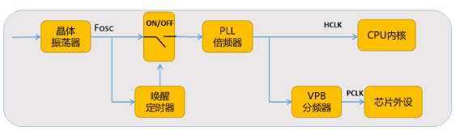
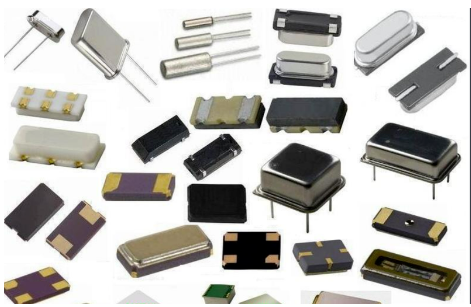
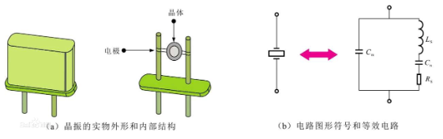
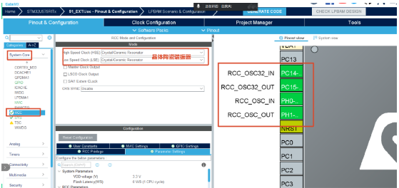
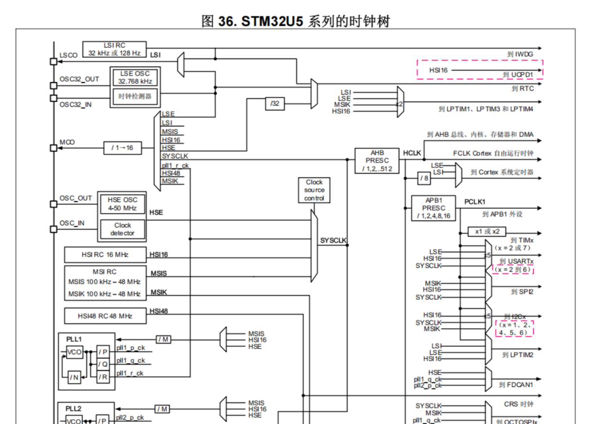

# STM32（51-07 时钟系统）

---

## 1. 时钟系统

### 基本概念

时钟是嵌入式系统的脉搏，（在电子系统中，时钟信号可以被理解为一个周期性的信号，它确定了系统的节奏和时间基准）处理器内核在时钟的驱动下完成指令执行、状态切换等动作的。外部设备在时钟驱动下完成各项工作。比如：串口通信（异步通信，每一个设备都有自己单独的时钟系统）、AD转换、定时器计数...

因此时钟对于计算机系统是非常重要的，如果时钟系统出现问题往往也是致命的，比如振荡器不起振、振荡不稳、停振等。时钟信号推动单片机内各个部分执行相应的指令，时钟就像人的心跳一样。

时钟系统的作用：通信同步，时序控制，计时功能

### 时钟系统的组成

振荡器，唤醒定时器，倍频器，分频器



- **振荡器**：产生时钟信号的源头。
- **唤醒定时器**：使能，关闭功能。
- **倍频器**：放大时钟频率。
- **分频器**：减小时钟频率。

### 常见的振荡器

振荡器主要分为：晶体振荡器，RC振荡器，LC振荡器



#### 晶体振荡器

晶体振荡器是一种电子元件，用于在电路中提供准确的时钟信号。它由一个晶体振荡器和相应的驱动电路组成，通常用于数字电路、微控制器、计算机等系统中。

晶体振荡器使用石英晶体作为振荡元件。石英晶体具有压电效应，当施加电场时，会以固定频率产生机械振动。晶体振荡器利用石英晶体的这种特性，通过电子电路驱动晶体振荡，产生稳定的振荡信号。晶体振荡器的频率稳定性非常高。



- 优点：晶体振荡器的振荡信号稳定且精度较高，连接的方式简单。
- 缺点：价格高，需要较长的起振时间。

#### RC 振荡器

RC振荡器使用电阻和电容器构成一个简单的振荡回路。当电容器充放电达到某个阈值时，会产生周期性的振荡信号。RC振荡器通常用于低频、中频等信号的产生和调制。

- 优点：成本更低，由电容和电阻组成，起振时间短
- 缺点：精度低，不够稳定，容易收到环境因素的影响

#### LC 振荡器

LC振荡器使用电感和电容器构成一个振荡回路。在LC振荡回路中，电感和电容器通过能量交换产生周期性的振荡信号。通常用于射频、高频等电路的信号产生。

LC振荡器的频率稳定性较好，但相比RC振荡器，其结构复杂、尺寸较大。

#### 总结

RC振荡器和LC振荡器是简单的振荡器，适用于一些低要求的应用场景，而晶体振荡器则具有更高的频率稳定性和精度，适用于对时钟信号要求较高的电子系统中

### 倍频器

cpu需要更高的频率，但是晶体振荡器的制作成本较高（而且频率越高，自身的频率也不稳定），不适合直接生产高振荡器，所以需要用到倍频器对现有的时钟频率进行放大。

### 分频器

外设需要不同的频率，为了降低功耗，进行分频，以保证不同的时钟信号

### STM32U5 的时钟源

### 在 MX 中如何开启外部时钟



### STM32 时钟树



### 时钟树的作用

时钟树（Clock Tree）是数字电路（尤其是集成电路和系统级芯片，SoC）中的关键组成部分，其核心作用是为芯片内部各个模块提供稳定、同步的时钟信号，确保数据在正确的时间被处理和传输。

### MX 时钟树的配置

---

## 2. SysTick 定时器

### 概念

SysTick又称滴答定时器。是一个定时设备，位于Cortex-M33内核中，和NVIC捆绑（可以产生中断信号），产生SysTick异常，可以对输入的时钟进行计数，系统定时器一般用于操作系统，用于产生时基，维持操作系统的心跳。

- 频率（f）：单位：HZ      代表每秒钟振荡的次数
- 1MHZ = 1000KHZ = 1000 000HZ
- 周期（T）：单位  s       代表振荡一次需要的时间
- 1s = 1000ms = 1000 000us
- 二者的关系：   T = 1/f
- 1KHZ代表每秒钟振荡1000次，振荡一次需要的时间 1/1000 = 1ms

### 工作原理

滴答定时器本质上就是一个24位递减计数器，也就是最大计数是2^24 - 1（0xFFFFFF）。 在给Systick设定初值后，每当到来一个时钟信号，计数值则减1，直到计数值减到0时，触发一次异常事件，处理异常服务程序，处理完成后计数器再自动重装初值并继续减一，依次循环。

比如现在输入的时钟频率为1MHZ，定时1ms如何配置自动重载数值寄存器？

```text
1MHZ-》每秒钟振荡1000 000 次-》震荡一次需要1us-》1ms-》振荡1000次，我们只需要让计数器计数1000个数-》自动重载数值寄存器1000-1；
```

时钟频率： 16MHZ   计时1ms

```text
16MHZ-》1/16us->1us 16次    1ms-》16000次      计数16000 -1
重载数值寄存器：16000-1
```

32MHZ   计时200ms

```text
32MHZ-》1/32us->1us 32次   1ms-》32000 -》200ms -》64000 00次 -1
重载数值寄存器：6400000-1
```

### 滴答定时器源码分析

滴答定时器系统默认开启

1. 打开keil5初始化的函数接口
2. 滴答定时器的时间配置
3. 配置滴答定时器中断
4. 时钟频率：4MHZ，定时时间为1ms

```text
4MHZ-》1/4us  1us->4次    1ms-》4000次    重载数值寄存器 4000-1
```

5. 分析验证

先找出这个函数各个参数的值

```text
SystemCoreClock = 4000000       4MHZ

uwTickFreq = 1u

SystemCoreClock / 1000UL / (uint32_t)uwTickFreq
      4000000  /   1000  /     1     =   4000;
```

这个函数的参数我们算出等于 4000

6. 接下来我们寻找函数

经过验证我们发现每间隔1ms产生一次中断的情况是成立的

到此我们又会出现一个新的问题：每间隔1ms触发的中断，中断服务程序中进行了哪些工作呢？

1. 查找中断向量表，找到滴答定时器的中断服务程序的入口
2. 通过入口函数我们找到了中断回调函数
3. 目的

我们找到每间隔1ms产生中断的目的让uwTick自加1

uwTick：在滴答定时器（SysTick）中，uwTick 是一个关键的全局变量（通常定义为 volatile uint32_t），其核心作用是记录系统启动后的毫秒级时间累计值，为嵌入式系统提供精确的时间基准。

### 手搓 1s 延时

---

## 3. 定时器

滴答定时器在内核里面的（ARM公司设计）定时器（TIM）（ST芯片厂商设计）

### 基本概念

定时器类似于我们生活中的闹钟，可以设定一个时间来提醒我们。定时器可以作为基本的定时器/计数器，用于生成周期性的定时中断或作为计数器来计数外部事件的脉冲数。例如1秒钟进入定时器中断干一件事，定时器可以配置为产生脉冲宽度调制（PWM）信号，用于控制电机速度、LED亮度调节，风扇风速调节，等应用。

定时器是存在于STM32U5单片机中的一个外设，总共有11个定时器，分别是2个高级定时器（TIM1,TIM8）7个通用定时器（TIM2,TIM3,TIM4,TIM5,TIM15,TIM16,TIM17）和2个基本定时器（TIM6,TIM7）

定时器的基本结构是通用的，很多模块电路都能用到，所以STM32定时上扩展了非常多的功能，根据复杂度和应用场景分为了高级定时器、通用定时器、基本定时器三种类型。

### 定时器的基本框图

### 时基单元

三大件：PSC（预分频器），ARR（自动重装载寄存器），CNT（计数器）

- 预分频器
- 自动重装载寄存器
- 计数器

### 计数模式

- 向上计数模式：计数器从0开始计数，当达到自动装载寄存器(TIMx_ARR)里的值时，自动清零且产生一个溢出事件，然后再从0开始向上计数。
- 向下计数模式：计数器从自动装载寄存器(TIMx_ARR)里的值开始递减计数，当计数值达到0时产生一个定时器溢出事件，并重装初值，继续向下计数。
- 中央对齐模式：又称为向上/向下计数，计数器从0开始递增达到ARR的值，产生一个定时器溢出事件，再从ARR的值递减到0，产生一个定时器溢出事件。

### 定时时间的配置

定时时间（S） = 预分频系数+1 * 自动重装载寄存器+1 / 时钟频率

频率为32MHZ，计时10ms，如何配置PSC和ARR？

```text
0.01s = ？ *   ？    /     32000 000
? * ? =  320000
PSC:100 -1
ARR:3200 -1
```

### 练习

- 72MHZ，计时 500ms，如何配置PSC和ARR？

  ARR：36000-1，PSC：1000-1

- 4MHZ，计时 200ms，如何配置PSC和ARR？

  ARR：8000-1，PSC：100-1

- 16MHZ，计时 700ms，如何配置PSC和ARR？

  ARR：11200-1，PSC：1000-1

### 定时器的实验

实验要求：使用定时器每间隔1s切换蜂鸣器的状态

1. 寻找想要使用的定时器连接的总线
2. 观察时钟频率

知道了定时时间以及时钟频率我们算出ARR：4000-1    PSC：1000-1

**MX 配置**：

1. 配置定时时间
2. 开启中断
3. 开启蜂鸣器

**代码编写**

### 定时器中断回调函数

```c
__weak void HAL_TIM_PeriodElapsedCallback(TIM_HandleTypeDef *htim)
{
  /* Prevent unused argument(s) compilation warning */
  UNUSED(htim);

  /* NOTE : This function should not be modified, when the callback is needed,
            the HAL_TIM_PeriodElapsedCallback could be implemented in the user file
   */
}
```

---

## 4. PWM

### PWM 定义

PWM，全称为脉冲宽度调制（Pulse Width Modulation），是一种调节信号的方法。简单来说，PWM 就是通过改变信号的高电平和低电平的时间比例来控制输出的平均电压或功率。

想象一下，我们有一个周期性的信号，其中高电平表示"开"状态，低电平表示"关"状态。PWM 就是在一个固定的时间周期内，通过改变高电平和低电平的持续时间来控制信号的特性。例如，如果我们将高电平持续时间设为较长，低电平持续时间设为较短，那么平均电压或功率就会比较高。相反，如果高电平持续时间设为较短，低电平持续时间设为较长，平均电压或功率就会比较低。

通过不断地调整高电平和低电平的持续时间比例，我们可以得到不同的输出效果。这种方法常用于控制电机的速度、调光灯的亮度、音频设备的音量等。

### PWM 参数

- 周期：高低电平变化所需要的时间       T=1/f
- 频率：在1秒内,信号变化（高电平到低电平再回到高电平）的次数，也就是PWM在1秒钟有多少周期，Hz.
- 占空比： 在一个脉冲周期内，高电平的时间占整个周期时间的比例，单位是% (0%-100%)。
- 输出的平均电压 = 输入的额定电压 X 占空比

### PWM 的生成原理

1. 输入滤波器和边沿检测：平滑时钟曲线，改变信号的质量，精准的控制时间，准确的检测到时钟的边沿，确保PWM波形的周期和占空比的准确性。
2. 预分频器：对过滤好的时钟信号进行分频，生成计数时钟，分频系数由PSC寄存器决定，可以调整计数频率。
3. 捕获比较寄存器：定时器中有多个捕获比较寄存器，用于存储比较的值，当计数器的值与捕获比较寄存器的值相匹配的时候会触发相应的输出控制。
4. 输出控制：每一个捕获会比较寄存器都会对应一个输出通道，输出控制模块根据计数器和捕获比较寄存器的值以及设置好的输出设置，生成PWM信号。

### 常见的 PWM 生成模式

下面我们以PWM模式1的向上计数进行理解

**输出过程**：

- 当0-t1这段时间，计数器寄存器的CNT的值是小于CCR，输出高电平。
- 当t1-t2这段时间，计数器寄存器的CNT的值是大于CCR且小于ARR的，输出低电平。

PWM模式2动图

### PWM 实验

实验要求：使用PWM控制风扇（用按键）

**MX 配置**：

1. 按键的引脚（PC9）配置为外部的中断
2. 开启按键的中断
3. 配置风扇的引脚为PWM模式

**代码编写**

---

## 回放

- 录制：白昊天的个人会议室
- 日期：2026-08-05 08:55:52
- 录制文件：https://meeting.tencent.com/crm/2YY7MBzQ61


- [STM32（51-07 时钟系统）](#stm3251-07-时钟系统)
  - [1. 时钟系统](#1-时钟系统)
    - [基本概念](#基本概念)
    - [时钟系统的组成](#时钟系统的组成)
    - [常见的振荡器](#常见的振荡器)
      - [晶体振荡器](#晶体振荡器)
      - [RC 振荡器](#rc-振荡器)
      - [LC 振荡器](#lc-振荡器)
      - [总结](#总结)
    - [倍频器](#倍频器)
    - [分频器](#分频器)
    - [STM32U5 的时钟源](#stm32u5-的时钟源)
    - [在 MX 中如何开启外部时钟](#在-mx-中如何开启外部时钟)
    - [STM32 时钟树](#stm32-时钟树)
    - [时钟树的作用](#时钟树的作用)
    - [MX 时钟树的配置](#mx-时钟树的配置)
  - [2. SysTick 定时器](#2-systick-定时器)
    - [概念](#概念)
    - [工作原理](#工作原理)
    - [滴答定时器源码分析](#滴答定时器源码分析)
    - [手搓 1s 延时](#手搓-1s-延时)
  - [3. 定时器](#3-定时器)
    - [基本概念](#基本概念-1)
    - [定时器的基本框图](#定时器的基本框图)
    - [时基单元](#时基单元)
    - [计数模式](#计数模式)
    - [定时时间的配置](#定时时间的配置)
    - [练习](#练习)
    - [定时器的实验](#定时器的实验)
    - [定时器中断回调函数](#定时器中断回调函数)
  - [4. PWM](#4-pwm)
    - [PWM 定义](#pwm-定义)
    - [PWM 参数](#pwm-参数)
    - [PWM 的生成原理](#pwm-的生成原理)
    - [常见的 PWM 生成模式](#常见的-pwm-生成模式)
    - [PWM 实验](#pwm-实验)
  - [回放](#回放)
