# STM32 串口通信（USART）

> 来源笔记：51-03 USART

---

## 1. 串口通信

### 1.1 什么是串口

一种可以将接收来自 CPU 的并行数据字符转换为连续的串行数据流发送出去，同时可将接收的串行数据流转换为并行的数据字符供给 CPU 的器件。一般完成这种功能的电路，我们称为串行接口电路或串行通信接口电路。

### 1.2 什么是通信

1. 至少有两个端：发送端、接收端
2. 信息的传递
3. 数据的交互

### 1.3 电平信号和差分信号

**电平信号**

电平信号通过单一信号线的电压高低表示逻辑状态，高电平（通常为 +5V、+3.3V 或更高）代表逻辑 “1”，低电平（通常为 0V 或接近 0V）代表逻辑 “0”。

**差分信号**

差分信号通过两根信号线（如 V+ 和 V-）的电压差值传递信息，逻辑状态由差值正负决定。

---

## 2. 通信的划分

### 2.1 按通信方式划分

| 类型 | 说明 | 传输方式 | 优点 | 缺点 |
|------|------|---------|------|------|
| 串行通信 | 同一时刻只能接收或者发送 1 Bit 的信息，因此只需要使用一根信号线即可 | 数据一位一位的串起来，逐个按位进行传输 | 节省引脚资源 | 传输速度慢 |
| 并行通信 | 同一时刻可以传输一个数据的多个位，因此需要多根信号线 | 使用多根数据线一次传输一个数据的多个位，同时进行传输 | 传输速度快 | 占用引脚资源多 |

### 2.2 按通信方向划分

| 类型 | 说明 | 数据线 | 例子 |
|------|------|--------|------|
| 单工通信 | 要么接收，要么发送，只能作为接收设备或者发送设备 | 一根单向的数据线 | 广播 |
| 半双工 | 既可以接收也可以发送，但是不能同时进行 | 一根双向的数据线 | 对讲机 |
| 全双工 | 可以在同一时刻发送或者接收 | 至少两根数据线 | 手机 |

### 2.3 按时钟信号划分

**同步通信**

通信双方根据同步信号通信，比如双方有一个共同的时钟信号（SPI 全双工、I2C 半双工）。

发送数据的时候会出现阻塞状态，需要等待数据传输完毕，程序才会执行到下一行。

**异步通信**

通信双方有自己独立的系统时钟，大家约定好通信的速度。异步通信不需要同步信号，但是并不是说通信的过程不同步（UART）。

发送数据的时候没有阻塞状态，执行发送数据语句后直接执行下一行语句。

### 2.4 通信速率

- 通信速度：单位时间内接收或者发送的数据的位数
- 波特率：每秒钟发送的位数
- 单位：bit/s、bps
- 常见的波特率：9600bps、115200bps

### 2.5 常见的通信协议

---

## 3. USART 和 UART

### 3.1 简单介绍

USART 能够灵活地与外部设备进行全双工数据交换，满足外部设备对工业标准 NRZ 异步串行数据格式的要求。USART 通过小数波特率发生器实现了多种波特率（可配置的波特率）。

USART 不仅支持同步单向通信和半双工单线通信，以及 LIN（局域互连网络）、智能卡协议、IrDA（红外线数据协会）SIR ENDEC 规范和调制解调器操作（CTS/RTS），还支持多处理器通信。

- **USART**：支持同步通信或者异步通信，全双工，串行
- **UART**：没有时钟线，只支持异步通信，全双工，串行
- 实际上 USART 和 UART 是一种包含的关系，当 USART 选择放弃时钟线的时候就是 UART

### 3.2 通信结构

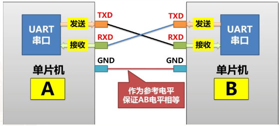

### 3.3 功能框图

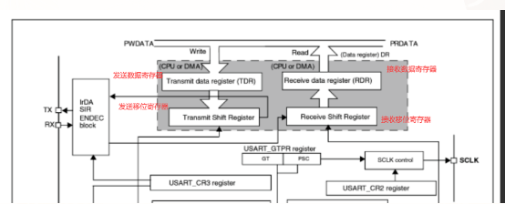

### 3.4 发送的过程

1. 由 CPU 或者 DMA 往 TDR 中写入数据
2. 然后由硬件自动检测发送移位寄存器中是否有数据正在移位：
   - 如果此时有数据正在移位，则数据等待当前移位寄存器移位完成后再往移位寄存器中放，此过程也是硬件执行。当 TDR 中的数据放到移位寄存器中的那一刻，TDR 空，这时候中断状态寄存器的 TXE 置 1，它来表示发送数据寄存器空。
   - 如果此时没有数据正在移位，则直接由硬件将 TDR 中的数据放到发送移位寄存器中。
3. 需要注意的是：当 TDR 中的数据在等待往移位寄存器中放的时候，如果此时 CPU 或者 DMA 继续向 TDR 中写入数据，会将 TDR 中的数据覆盖掉。

### 3.5 接收的过程

1. 首先数据线通过 RX 口连到接收移位寄存器
2. 接收移位寄存器对线上的电平进行读取，将读取到的数据放到最高位，读下一位数据时，先把已有的位整体往右移一位，然后再将读到的数据放到最高位，以此往复，直到读满 8 位。
3. 读满八位以后整体往 RDR 中放，此时 RDR 非空，中断状态寄存器标志位 RXNE 置 1，它来表示 RDR 非空。

---

## 4. 串口通信协议

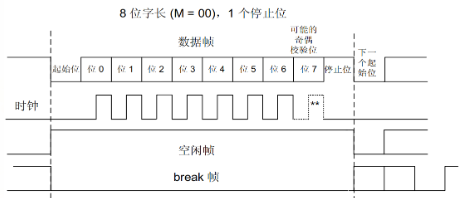

### 4.1 数据帧格式的组成

1. **空闲状态**：信号线保持在高电平（高电平的抗干扰能力更强）
2. **起始位**：1 bit，低电平表示通信的开始
3. **数据位**：7、8、9 位可选择
4. **校验位**（可配置，可忽略）：如果不设置校验位，此处充当普通的数据位
   - 奇校验：数据位上 1 的个数 + 校验位上 1 的个数 = 奇数
   - 偶校验：数据位上 1 的个数 + 校验位上 1 的个数 = 偶数
   - 注意：校验位的设置仅仅只能发现传输过程中的错误，但是不能修改
5. **停止位**：将信号线拉回高电平的状态（可配置）

### 4.2 逻辑电平标准

**TTL**

- TTL 电平：逻辑 1：2.4V-5V；逻辑 0：0-0.5V
- TTL 电平下的串口通信协议：

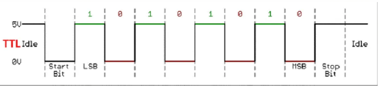

**RS-232**

- 电平标准：
  - +3 ~ +15V：代表逻辑 0
  - -3 ~ -15V：代表逻辑 1
- RS-232 电平下的串口通信协议：

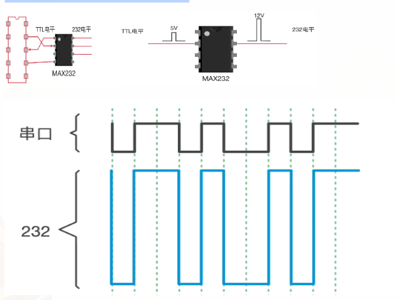

- RS232 的抗干扰能力更强

**RS-485**

RS-485 仅是一个电气标准，描述了接口的物理层，像协议、时序、串行或并行数据以及链路全部由设计者或更高层协议定义。RS-485 定义的是使用平衡多点传输线的驱动器和接收器的电气特性。

RS-485 能够进行远距离传输主要得益于使用差分信号进行传输，当有噪声干扰时仍可以使用线路上两者差值进行判断，使传输数据不受噪声干扰。

- 半双工、是电气协议（逻辑 1：+2V–+6V；逻辑 0：-6V—-2V）
- 是二线制差分信号，也就是实际传输的数据是通过判断这两条信号线上的电压差来实现的
- RS-485 总线弥补了 RS-232 通信距离短、速率低的缺点
- RS-485 的速率可高达 10Mbit/s，理论通讯距离可达 1200 米
- RS-485 和 RS-232 的单端传输不一样，是差分传输，使用一对双绞线

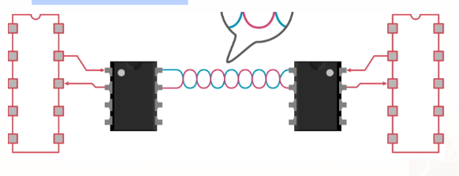

### 4.3 三种电平标准对比

| 标准 | 类型 | 逻辑 1 | 逻辑 0 | 特点 |
|------|------|--------|--------|------|
| TTL | 单端 | 2.4V-5V | 0-0.5V | 近距离、板内 |
| RS-232 | 单端 | -3 ~ -15V | +3 ~ +15V | 抗干扰比 TTL 强，距离短、速率低 |
| RS-485 | 差分 | +2V–+6V | -6V—-2V | 半双工，可高达 10Mbit/s，理论 1200 米 |

---

## 5. 串口相关寄存器

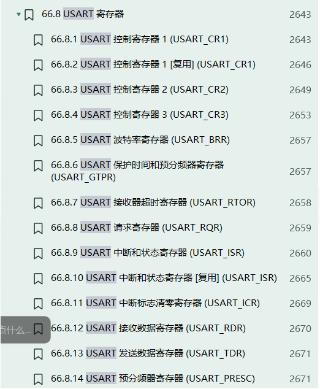

### 5.1 串口控制寄存器

- `USART_CR`
  - `USART_CR1`
  - `USART_CR2`
  - `USART_CR3`
- 决定数据帧的格式（设备功能初始化、通信帧格式配置）

### 5.2 波特率寄存器

- `USART_BRR`：决定通信速度（bps、bit/s）

### 5.3 数据发送寄存器

- `USART_TDR`：决定发送的数据，将要发送的数据写入

### 5.4 数据接收寄存器

- `USART_RDR`：决定接收的数据，将要接收数据的读取

### 5.5 中断和状态寄存器

- `USART_ISR`

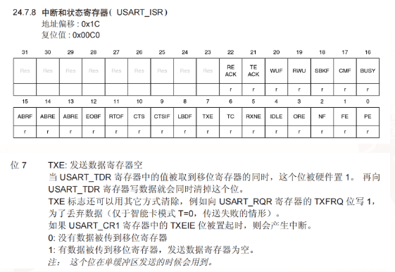

---

## 6. 串口实验

### 6.1 串口发送实验

**分析原理图**

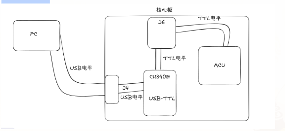

连接发送和接收的两个引脚为 PA9 和 PA10。

**MX 配置**

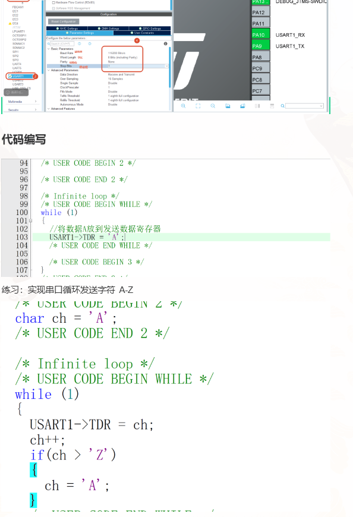

如果不加延时会出现乱序，因为往 TDR 中放入数据的时候速度过快，导致 TDR 中的值被覆盖。

解决办法：

- 如果不加延时如何解决？
- 在 CPU 向 TDR 写入数据之前，先判断 ISR 位 7，TXE 是否为 1

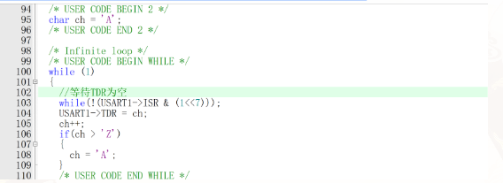

**HAL 库函数进行发送**

函数分析：

```c
HAL_USART_Transmit(USART_HandleTypeDef *husart, const uint8_t *pTxData,
                   uint16_t Size, uint32_t Timeout)
```

- 功能：以阻塞的形式发送大量的数据
- 参数：
  - 句柄
  - 要发送的数据
  - 要发送的数据的大小
  - timeout 超时检测
- 返回值：不关心

代码分析：

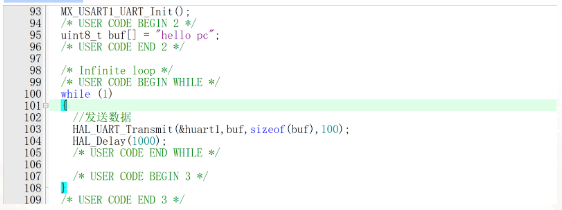

---

# 串口重定向
int printf(const char * format,...)
printf函数底层调用的是fputc函数，fputc是将要发送的数据写入到标准输出流stdout
__weak int fputc(int /*c*/, FILE * /*stream*/) 
因此如果想让printf将数据输出到串口，需要重写fputc 
WEAK弱符号
weak 顾名思义是“弱”的意思，所以如果函数名称前面加上__weak 修饰符，我们一般称这个函数为“弱函数”。
加上了__weak 修饰符的函数，用户可以在用户文件中重新定义一个同名函数，最终编译器编译的时候，会选择用户定义的函数，如果用户没有重新定义这个函数，
那么编译器就会执行__weak 修饰的函数，并且编译器不会报错。
## 重定向步骤
### 1.打开C库

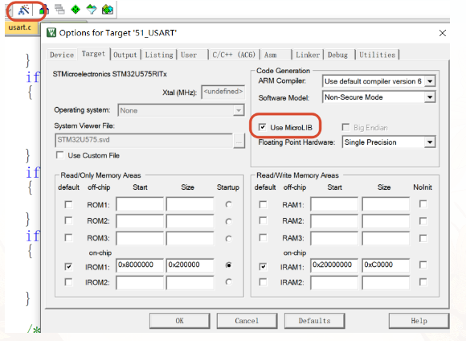

### 2.添加头文件

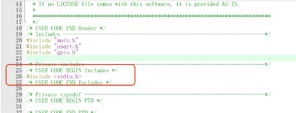

### 3.重写fputc
```c
int fputc(int ch,FILE *p)
{
	//等待TDR为空
	while(!(USART1->ISR &(1<<7)));
	USART1->TDR = ch;
	return ch;
}

int fputc(int ch,FILE *p)
{
	HAL_UART_Transmit(&huart1,(uint8_t *)&ch,1,100);
	return ch;
}
```

### 4.调用printf

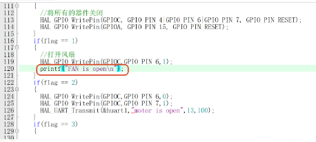

## 串口接收实验
### 函数分析
```c
HAL_UART_Receive (USART_HandleTypeDef * huart, uint8_t * pRxData, uint16_t Size, uint32_t Timeout)
功能：以阻塞的形式接收大量的数据
参数：句柄
      接收到的数据存放的位置
      接收数据的大小
      超时检测
返回值：状态信息

```
### 代码编写
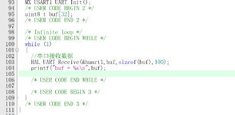
# 5.Debug调试的用法
注意：使用Debug之前一定要保证连接好调试器（ST-link）
怎么使用Dbeug查看接收到的数据呢
## 1.将接收数据的数组定义为全局变量
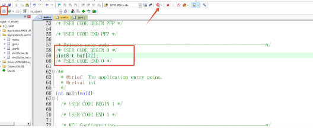
## 2.添加调试视图
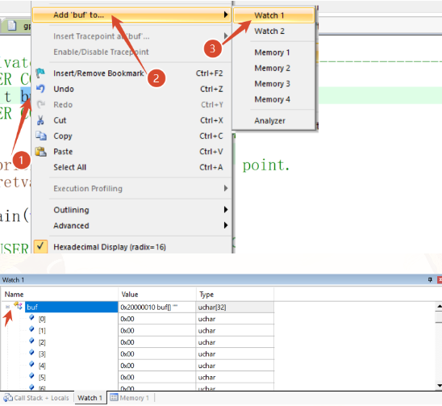
## 3.运行代码
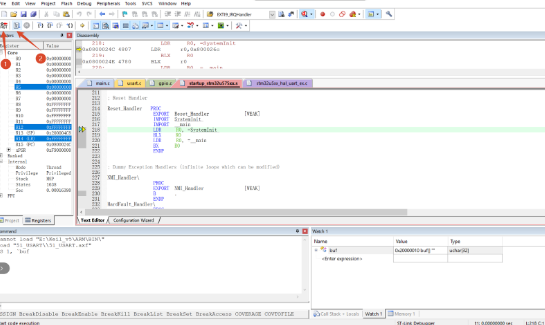
## 4.连接串口，发送数据，查看效果
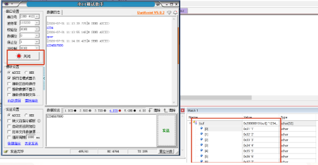
## Debug常见的按钮功能
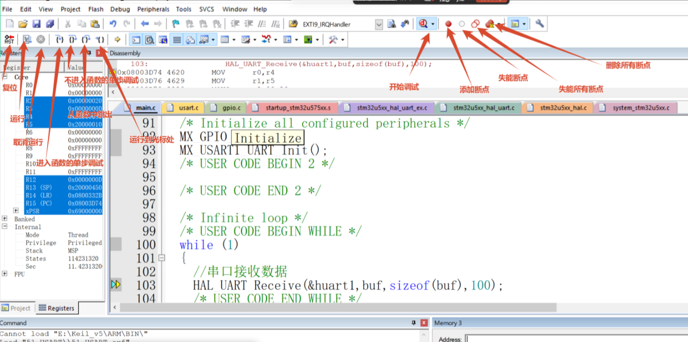


## 7. 作业

1. 思维导图，问题反馈
2. 使用按键控制蜂鸣器、马达、风扇、LED，每按一下控制一个器件
3. 选做（使用串口发送，这几个执行的状态）

会放链接

- 录制：USART
- 日期：2026-07-30 09:01:11
- 录制文件：https://meeting.tencent.com/crm/NAYqGBBE2c

